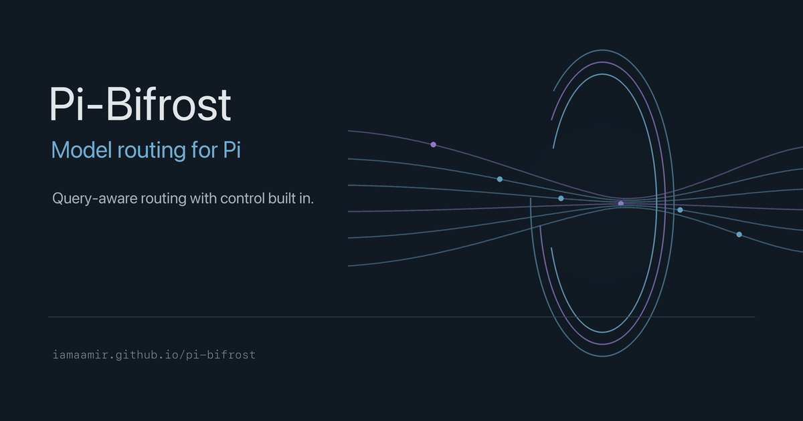
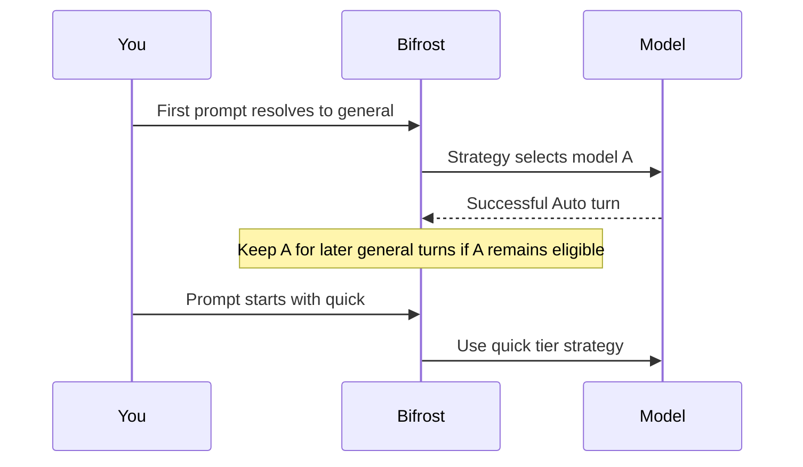

# Pi-Bifrost

[Getting started](docs/guide/getting-started.md) · [Configuration](docs/guide/configuration.md) · [Classifier backends](docs/guide/classifiers.md) · [Troubleshooting](docs/guide/troubleshooting.md) · [Examples](examples/README.md) · [Development](DEVELOPMENT.md)



## What Bifrost does

Pi-Bifrost chooses a suitable model for each message from the models you allow. You spend less time selecting and switching models by hand.

A tier is a named model group, such as `quick` or `general`. A classifier is an extra AI call that chooses a tier. It cannot choose a model outside your lists.

## Router SDK

Use Bifrost's routing engine without running Pi. Other applications can give Bifrost their model inventory and configuration, and get back an advisory, inspectable route decision they execute themselves.

```js
import { createRouter } from "pi-bifrost/router";
```

The Pi packages are optional peer dependencies; a standalone consumer installs the package without Pi, API keys, or network access on the default path. See [docs/router-api.md](docs/router-api.md) and the shipped `examples/router-standalone.mjs` plus `examples/host-adapter.mjs`.

## Install

Connect and sign in to a model provider in Pi before you install Bifrost.

```bash
pi install npm:pi-bifrost
```

Fresh installs route by default. Before Pi sends your message, Bifrost chooses the active model in Pi.

When no route file, meaningful configuration, runtime routing preference, or explicit routing override blocks setup, Bifrost loads provisional model lists from Pi's catalog before it sends your first message. It checks model access in the background, then saves only successful generated pools to `.pi/bifrost.json`. An empty `{}` file does not block setup. A configuration with settings does.

Provisional pools are catalog entries, not proof that a model works. Background probes send small provider requests and can use credits or reach rate limits. If no model passes, Bifrost leaves configuration unchanged and warns you. The generated configuration adds no prompts or credentials. See [Getting started](docs/guide/getting-started.md).

Select `bifrost/auto` in Pi's `/model` picker to let Bifrost choose which model answers each message. The footer shows Auto and the selected model. Use `/bifrost inspect` or `/bifrost debug` to see model lists and status without a classifier call. Pi's list does not prove a model will work.



Run `/bifrost init` to refresh Pi's model list or reconcile model pools. It reuses probe results from the last hour; otherwise it checks models before it proposes changes. Pass `-f` to force fresh probes. Probes can use credits or reach rate limits. Init preserves other configuration fields and handwritten model entries. It asks once before saving, but its summary does not list every model ID or how Bifrost chooses among models.

By default, Auto can keep a successful model for later messages in the same tier while it remains allowed. A different tier uses its own model selection rule. See [Auto routing](docs/guide/auto-routing.md).

## Configure tiers

Edit your existing configuration to keep its model lists and settings. If you have no configuration, init can save starter lists first.

```json
{
  "default": "general",
  "models": {
    "quick": ["provider/fast-model"],
    "general": ["provider/general-model"],
    "frontier": ["provider/frontier-model"]
  }
}
```

Replace the example IDs with models available in Pi. The [configuration guide](docs/guide/configuration.md) explains strategies, rules, reserves, billing preferences, and fallback tiers.

## Inspect and control routes

Use these commands in Pi:

| Command | Result |
| --- | --- |
| `/bifrost preview --offline <prompt>` | Show a route using local cache and rules. Makes no classifier request. |
| `quick <message>` | Use the `quick` tier once. Bifrost removes its name before sending the prompt. |
| `/bifrost pin` / `/bifrost unpin` | Keep the model or resume routing. |
| `/bifrost off` / `/bifrost on` | Stop or resume routing. |
| `/bifrost classifier off` | Stop the extra AI call that chooses a tier. |
| `/bifrost cache stats` / `/bifrost cache clear` | View or empty saved entries. |

See [all commands](docs/guide/commands.md) and [routing controls](docs/guide/routing-controls.md).

## Privacy and reliability

The classifier is on by default. The local cache saves earlier routing decisions. It stores simplified words from prompts and the chosen tier. Treat these as sensitive. Bifrost does not cache answers. If the cache has no matching decision, the classifier can receive the prompt.

`/bifrost classifier off` stops this call and works without a Bifrost configuration file. Pi still sends the prompt to your selected model service.

To stop using the local cache, add `"cache": { "enabled": false }` inside your existing configuration. Keep its model lists. This stops cache lookups and new classification entries. It does not clear saved entries. `/bifrost cache clear` empties them. If you have no configuration, run `/bifrost init` first. See [reliability and local cache](docs/guide/reliability-and-cache.md).

By default, a usage or billing rejection pauses all models with the same configured Pi provider ID. This applies to Auto and physical routing. It does not identify shared billing accounts. Set `reliability.allowanceCooldownScope` to `model` to limit the pause to one model. See [provider pauses](docs/guide/reliability-and-cache.md#provider-pauses-are-not-account-checks).

Auto can try another allowed model once after a usage or billing rejection. Pi must prove the failed turn was empty and safe to continue. The provider pause still applies when you disable the retry. See [Auto routing](docs/guide/auto-routing.md#recover-from-one-empty-allowance-failure) for the full limits.

Bifrost saves model failures locally and can stop using a model for a time. Bifrost does not fetch live usage limits from model services. See the [reliability guide](docs/guide/reliability-and-cache.md) and its [migration steps](docs/guide/reliability-and-cache.md#existing-users-migrate-reliability-state). Model changes can reduce prompt-cache reuse. Providers control cache use and billing. See [provider prompt caching](docs/guide/prompt-caching.md).

Set `reliability.retryOnAllowanceExhausted` to `false` to turn off the one Auto retry. Use `/bifrost reliability` to see active provider pauses. See [all commands](docs/guide/commands.md) for how to reset one provider pause.

## Advanced

[Bifrost Patterns](https://github.com/iamaamir/bifrost-pattern) · [Experimental resolve-only router API for Node.js](docs/router-api.md).

## License

MIT. See [LICENSE](LICENSE).
