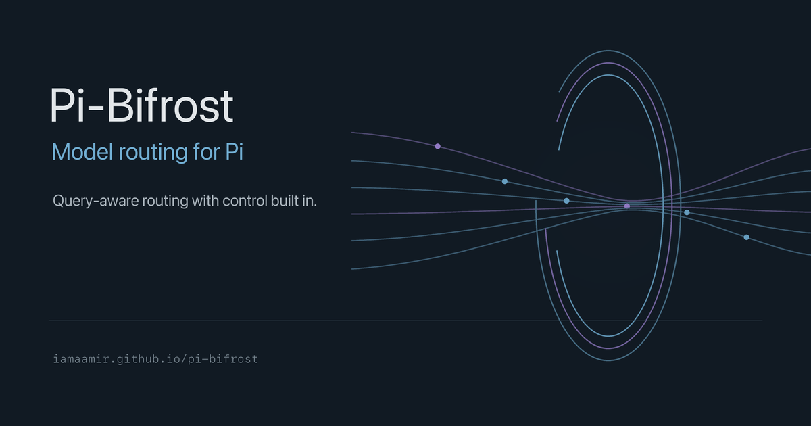
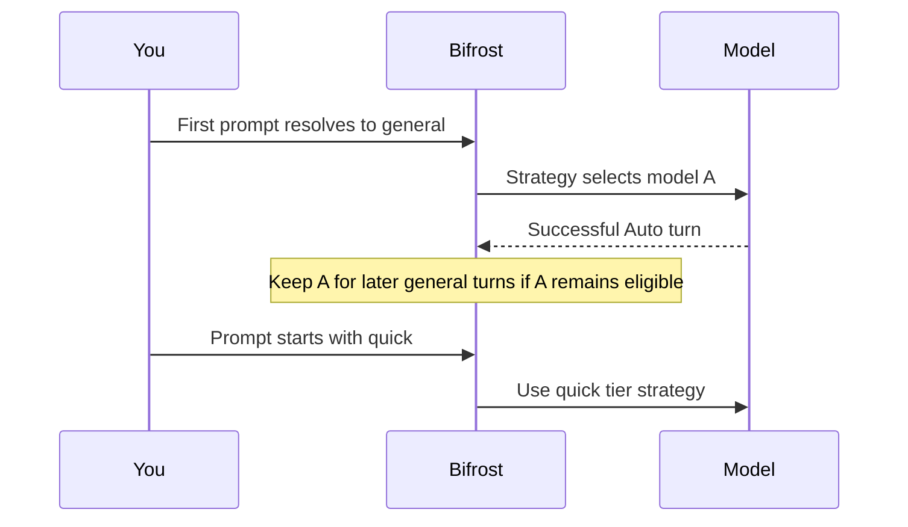

# Pi-Bifrost

[Getting started](docs/guide/getting-started.md) · [Configuration](docs/guide/configuration.md) · [Classifier backends](docs/guide/classifiers.md) · [Troubleshooting](docs/guide/troubleshooting.md) · [Examples](examples/README.md) · [Development](DEVELOPMENT.md)



## What Bifrost does

Pi-Bifrost chooses a suitable model for each message from the models you allow, so you spend less time selecting and switching models by hand.

A tier is a named model group, such as `quick` or `general`. A classifier is an extra AI call that chooses a tier; your configured model lists still bound the choice.

## Router SDK

Use Bifrost's routing engine without running Pi. Other applications can give Bifrost their model inventory and configuration, and get back an advisory, inspectable route decision they execute themselves.

```js
import { createRouter } from "pi-bifrost/router";
```

A standalone consumer installs the package without Pi, API keys, or network access on the default path. See [docs/router-api.md](docs/router-api.md) and the shipped `examples/router-standalone.mjs` plus `examples/host-adapter.mjs`.

## Install

Connect and sign in to a model provider in Pi before you install Bifrost.

```bash
pi install npm:pi-bifrost
```

Fresh installs route by default. Before Pi sends your message, Bifrost chooses the active model in Pi.

When no saved configuration, route file, runtime routing preference, or explicit routing override exists, Bifrost loads provisional model lists from Pi's catalog before your first message. It checks model access in the background, then saves successful generated pools to `.pi/bifrost.json`. An empty `{}` file counts as no configuration; any configuration setting stops automatic setup.

Provisional pools come from the catalog. Background probes send small provider requests and can use credits or reach rate limits. If no model passes, Bifrost leaves configuration unchanged and warns you. The generated configuration includes pools and routing settings; prompt text and credentials stay out. See [Getting started](docs/guide/getting-started.md).

Select `bifrost/auto` in Pi's `/model` picker to let Bifrost choose which model answers each message. The footer shows Auto and the selected model. Use `/bifrost inspect` or `/bifrost debug` to see model lists and status without a classifier call. Pi's model list shows availability, not proof that a model is healthy.



Run `/bifrost init` to refresh Pi's model list or reconcile model pools. It reuses a recent complete saved probe report when it covers the current catalog; otherwise it probes. Pass `-f` to force a fresh check. Init preserves other configuration fields and handwritten model entries. It asks once before saving; `--write` skips that question. A session with no UI saves only when `--write` is present. See [Getting started](docs/guide/getting-started.md).

By default, Auto can keep a successful model for later messages in the same tier while it remains allowed. A different tier uses its own model selection rule. See [Auto routing](docs/guide/auto-routing.md).

## Configure tiers

Edit your existing configuration to keep its model lists and settings. If you have no configuration, init can save starter lists first.

```json
{
  "default": "general",
  "models": {
    "quick": ["provider/fast-model"],
    "general": ["provider/general-model"],
    "frontier": ["provider/frontier-model"]
  }
}
```

Replace the example IDs with models available in Pi. The [configuration guide](docs/guide/configuration.md) explains strategies, rules, reserves, billing preferences, and fallback tiers.

### Describe the goal instead

Bifrost ships a `configure-bifrost` skill and a `bifrost_config` tool, so you can describe the outcome you want instead of assembling the JSON yourself:

```text
Configure Bifrost for my coding workflow: cheap implementation with a strong
orchestrator and an independent reviewer, and no silent escalation to an
expensive model. Use the models I already have.
```

The agent reads Pi's real model list and your config files. It builds a candidate policy, checks it, previews routes offline, and explains the tradeoffs. It shows a tool-generated impact summary first. Bifrost writes one config file atomically after you approve the proposal. The agent writes only the configuration you approve; apply reloads Bifrost and reports whether the saved settings are active. Apply requires Pi's terminal UI (TUI). Press `a` to apply the summary, or `d` to inspect every exact change. In exact view, `n` and `p` move through pages, and `b` returns to the summary. Summary approval accepts the proposal as a whole; use exact view to inspect each value. Escape cancels. Use a terminal at least 40 columns by 8 rows to approve. Proposals above the 2,000,000-character review limit fail before the dialog and write nothing. In an RPC session, apply returns `approval_required`; repeat the check and approval in a TUI so every change is displayed.

You can also ask for the single tool directly. It has four operations: `inspect`, `check`, `preview`, and `apply`. See [the skill](skills/configure-bifrost/SKILL.md).

## Inspect and control routes

Use these commands in Pi:

| Command | Result |
| --- | --- |
| `/bifrost preview --offline <prompt>` | Show a route using local cache, rules, and the default tier only. |
| `quick <message>` | Use the `quick` tier once. Bifrost removes its name before sending the prompt. |
| `/bifrost pin` / `/bifrost unpin` | Hold the current model for this session or resume routing. |
| `/bifrost off` / `/bifrost on` | Stop or resume routing. |
| `/bifrost classifier off` | Disable the extra AI call for this Pi session. |
| `/bifrost cache stats` / `/bifrost cache clear` | View or empty saved entries. |

See [all commands](docs/guide/commands.md) and [routing controls](docs/guide/routing-controls.md).

## Privacy

The classifier is on by default. The local cache saves earlier routing decisions. It stores simplified words from prompts and the chosen tier; treat these terms as sensitive. The cache keeps classification terms only; assistant responses stay out. If the cache has no matching decision, the classifier can receive the prompt.

`/bifrost classifier off` disables this call for the current Pi session. The setting lasts for the session; after restart, Bifrost uses `classifier.enabled`. If legacy state conflicts with `classifier.enabled`, classification pauses until you choose a session setting. The selected generation provider still receives the prompt.

Add `"cache": { "enabled": false }` to your existing configuration, keep its model lists, and reload. This stops cache use; saved entries remain until `/bifrost cache clear`. If you have no configuration, run `/bifrost init` first. See [reliability and local cache](docs/guide/reliability-and-cache.md).

## Reliability

By default, a usage or billing rejection pauses all models with the same configured Pi provider ID in Auto and physical routing. Pauses use configured provider IDs and recorded request errors; account quota and charges stay with the provider. Set `reliability.allowanceCooldownScope` to `model` to limit the pause to one model.

Auto can try another allowed model once after a usage or billing rejection when `reliability.retryOnAllowanceExhausted` is `true`. Pi must prove the failed turn was empty and safe to continue. The provider pause applies whether or not you enable the retry. See [Auto routing](docs/guide/auto-routing.md#recover-from-one-empty-allowance-failure) and [provider pauses](docs/guide/reliability-and-cache.md#provider-pauses-are-not-account-checks).

Bifrost saves model failures locally and can stop using a model for a time. Switching models can reduce prompt-cache reuse; providers control cache use and billing. See the [reliability guide](docs/guide/reliability-and-cache.md), its [migration steps](docs/guide/reliability-and-cache.md#existing-users-migrate-reliability-state), and [provider prompt caching](docs/guide/prompt-caching.md).

Use `/bifrost reliability` to see active provider pauses. See [all commands](docs/guide/commands.md) to reset one provider pause.

## Advanced

[Bifrost Patterns](https://github.com/iamaamir/bifrost-pattern) · [Experimental resolve-only router API for Node.js](docs/router-api.md).

## License

MIT. See [LICENSE](LICENSE).

[](https://www.greptile.com/?utm_source=oss_badge&utm_medium=readme&utm_campaign=greptile_for_open_source)
