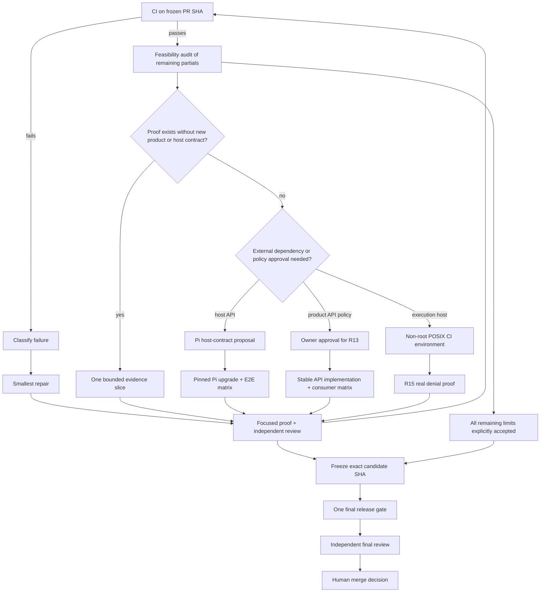

# PRD delivery execution plan

**Status:** active — CI required for current PR branch tip; see PR #186 checks

**Base:** `origin/v2`

**PR:** [#186](https://github.com/iamaamir/pi-bifrost/pull/186)

**Last updated:** 2026-10-24

This is a durable runbook for completing feasible PRD acceptance work. It is not release approval. `docs/acceptance-coverage.md` remains the requirement-status record; `change-evidence.json` remains the per-change evidence contract.

## Delivery graph

## Current checkpoint

| Item | State | Next owner action |
|---|---|---|
| Pi 1.4.0 baseline | Pushed in `e61a098` | CI proves compatibility; no compatibility claim before then. |
| R15 discovery failure | Reviewed in `905793c` | Keep partial: real POSIX denial requires non-root mode-enforcing host. |
| R05/R08 | Host/policy-blocked | Audit confirmed no status-closing Bifrost-only witness. R05 needs approved enforcement plus final dispatch veto; R08 needs Pi account binding and account-selectable dispatch. |
| R12 | Partial | Identify a real existing transport seam before adding coverage. No synthetic transport proof. |
| R14 | Partial | Identify a real serialization/trace seam before adding coverage. No universal privacy claim. |
| R03 | Host-blocked | Require Pi lifecycle hook for config/session/branch mutation before recovery settlement. |
| R04 | Host-blocked | Require typed capability observation contract with provenance. |
| R13 | Policy-blocked | Require approved stable API compatibility contract. |
| R16 | Finalization work | Run only after candidate freeze; bind artifacts to final SHA. |

## Work lanes

### Lane 0 — CI triage (blocking)

1. Record PR SHA, workflow URL, job name, failure log, and affected requirement in this file's `Recovery log`.
2. Classify failure as dependency upgrade, production regression, test/evidence error, infrastructure, or unrelated baseline failure.
3. Repair one root cause. Do not batch cleanup or refactors.
4. Run only targeted proof during repair. Push and return to CI.

### Lane 1 — feasible evidence

1. Audit exact partial wording in `docs/acceptance-coverage.md`.
2. Locate real production and host boundary.
3. Write a test-only witness and a fault control that makes its assertion fail.
4. Add one uniquely-owned `change-evidence.json` contract; shared-file ownership must stay unique.
5. Run focused proof, request one independent review, repair at most twice.
6. Keep requirement partial unless every stated limit is closed.

### Lane 2 — blocked contracts

Do not implement speculative Bifrost work.

- **R03:** prepare a concrete Pi upstream request: lifecycle point, mutation operation, observable result, and acceptance test.
- **R04:** prepare a concrete Pi host contract: typed capability fields, source/provenance, absence semantics, and consumer visibility.
- **R13:** request owner approval for semver, exports, error contract, deprecation period, and support boundary.
- **R15:** provision an unprivileged Linux CI job with a mode-bit-enforcing filesystem; retain fake-registry proof as lower-level coverage.

Each request must have an owner, dependency reference, and acceptance condition before dependent Bifrost work starts.

## Candidate freeze protocol

1. Stop all feature/evidence edits.
2. Record final SHA and `git status --short` output in release artifact.
3. Rebind evidence against `origin/v2` on that SHA.
4. Run prescribed release verification once on that SHA.
5. Attach result manifest, CI URLs, changed-file list, remaining partial limits, and independent review result.
6. Do not amend after verification. Any change starts a new freeze.

## Crash recovery protocol

On a new session, read in order:

1. This file.
2. `git status --short`, `git rev-parse HEAD`, and `git log --oneline origin/v2..HEAD`.
3. `docs/acceptance-coverage.md` and `change-evidence.json`.
4. Latest PR #186 check state.
5. `RELEASE-PLAN.md` and the most recent result manifest.

Then continue only one lane. Never infer a gate passed from old artifacts or branch names.

## Recovery log

| Date | SHA | Event | Evidence / next step |
|---|---|---|---|
| 2026-10-24 | `905793c` | PR pushed after Pi 1.4.0 baseline plus R15 repair. | CI `release-gates` and report publisher checks queued; local final gates intentionally deferred. |
| 2026-10-24 | `9b57b9d` | R05/R08 feasibility audit reviewed. | No status-closing Bifrost-only slice exists. Optional R05 tests do not close coverage and are deferred. |
| 2026-10-24 | `dad67ff` | PR #186 release-gate acceptance failed. | [Verification run 40085083293](https://github.com/iamaamir/pi-bifrost/actions/runs/40085083293) failed because `docs/testing-coverage.md` is declared by both `evidence-rebind-helper` and `r15-unknown-discovery-preserves-config`; remove the duplicate R15 declaration, run focused evidence tests, then return to CI. |
| 2026-10-24 | `6ebefae` | PR #186 evidence preflight passed; release gate failed. | [Verification run 40089816484](https://github.com/iamaamir/pi-bifrost/actions/runs/40089816484) passed declaration preflight, then failed because pinned-Pi integration and UI smoke still asserted Pi `1.0.1` after baseline moved to `1.4.0`; align those assertions and rerun focused proof. |
