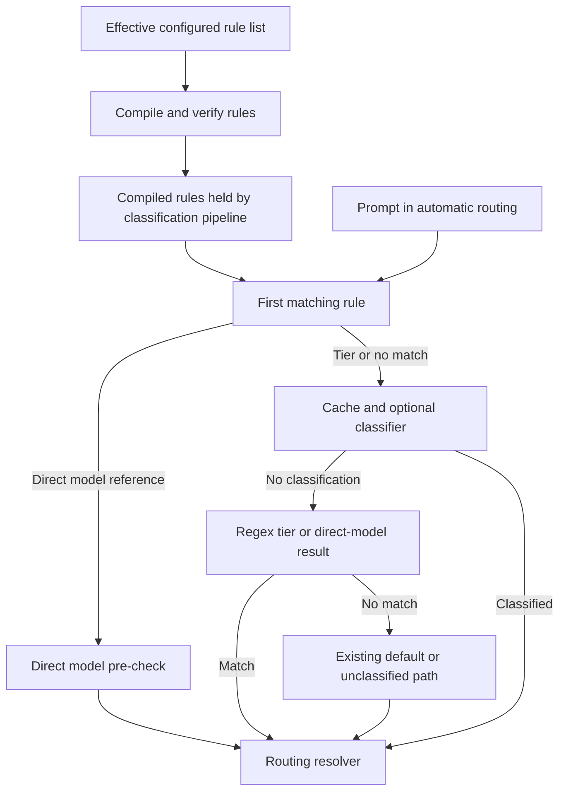
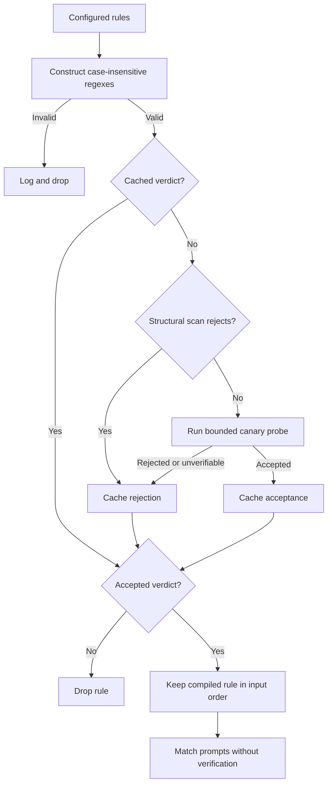
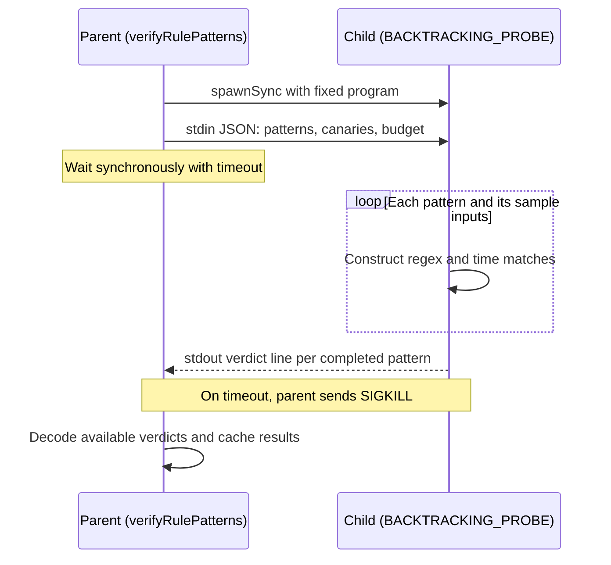

# Route rules

Bifrost's route rules map prompt text to a configured tier or a direct model reference using
user-defined regular expressions. This module implements the `rules` field in `bifrost.json`
and the rule lists loaded from `bifrost-routes.json`. It compiles and checks those patterns,
then matches prompts against the accepted rules.

## Example: route prompts by intent

The following illustrative configuration fragment assumes the `quick`, `general` and
`frontier` tiers are already configured in `models`:

```json
{
  "rules": [
    { "pattern": "\\breview\\b", "model": "frontier" },
    { "pattern": "\\bwrite tests\\b", "model": "general" },
    { "pattern": "\\bformat\\b", "model": "quick" }
  ]
}
```

| Prompt | Rule result |
| --- | --- |
| Review this pull request | `frontier` |
| Write tests for this function | `general` |
| Format this file | `quick` |
| Format this file and review the changes | `frontier` (first matching rule in list order) |
| Explain this function | No regex match |

These are rule-engine outcomes, not guaranteed final routing decisions. Matching is
case-insensitive. The `model` field can also name a direct `provider/model-id` reference
instead of a tier.

## Where rules participate in routing

[`config-load.ts`](../../config-load.ts) loads the effective rule list from the route-file
override or the configuration. [`classification-pipeline.ts`](../../classification-pipeline.ts)
compiles that list when it constructs a pipeline and reuses it for matching.
The standalone router uses the rules in its supplied configuration snapshot.



The diagram summarizes the classification path with configured tiers; explicit overrides
and other host controls are outside this module. Direct model references can take precedence
at the initial regex pre-check, while tier rules normally serve as a fallback after the cache
and optional classifier. The first matching rule is authoritative within each regex check;
it does not override every other routing decision.

The routing resolver remains responsible for candidate eligibility, tier strategies and
fallback. A rule supplies a routing target, not permission to dispatch a model request.

## Ownership

This capability owns:

- the rule contract (`RouteRule`, `CompiledRule`) and compilation (`compileRules`)
- compiled matching (`classifyCompiled`) and the deprecated per-call reference matcher
  (`classify`)
- pattern verification: the textual scan, the out-of-process canary probe, probe runtime
  selection and the verdict cache (`safety.ts`)

It owns nothing else. Rule discovery and route-file precedence (`config-load.ts`), the default
rule set (`config.ts`), live probe enablement (`config-agent.ts`), tier resolution, provider
scope, reliability, fallback and dispatch (`routing.ts`) stay with their existing owners.

`routing.ts` re-exports the five public names, so `pi-bifrost/routing` keeps every published
signature. `classification-pipeline.ts`, `config-agent.ts`, `config.ts`, `config-load.ts` and
`scripts/jev-benchmark.ts` import this owner file directly.

## Contract

`compileRules(rules)` compiles each `pattern` with the `i` flag and returns only the rules the
verifier accepts, in input order. An invalid pattern is logged and dropped. Rules match in
order: the first compiled rule whose pattern matches wins, so a rule earlier in the list beats
a later match that appears earlier in the text.

`classifyCompiled(text, compiled)` is a pure loop over already-compiled rules: it constructs no
`RegExp`, reads no environment, verifies nothing and spawns nothing. `classify(text, rules)` is
deprecated and exists as the parity reference; production uses compilation. `classify` constructs
a `RegExp` and checks verification for each rule it visits, so an uncached verdict can launch
a bounded verifier. Consumers that must not spawn use `classifyCompiled`.

## Safety checks are heuristic

JavaScript's `RegExp.test()` is synchronous. A pattern that requires excessive backtracking
can block the event loop: a timer, promise race or abort signal cannot interrupt a native
regex match. Running a test match in the Pi process would therefore expose the host itself
to the problem the verifier is trying to detect.

Two complementary defenses reduce that risk before rules reach normal matching:

1. **Textual scan** — rejects selected repeated-group and ambiguous-alternation shapes
   without executing the configured regex. Unmodeled constructs proceed to the probe.
2. **Canary probe** — executes patterns against ten fixed sample strings in a separate
   process, with a per-match timing threshold and a parent-enforced process timeout.



An accepted verdict means these heuristics did not reject the pattern. It does not prove
that the pattern has bounded execution time on every possible prompt. Fail-closed handling
of missing verdicts is distinct from a universal regex safety guarantee.

## How the backtracking probe works

[`safety.ts`](safety.ts) contains `BACKTRACKING_PROBE`, a fixed JavaScript program stored as
a string. It is the child-side verifier, not a regex or a user-supplied program.
`verifyRulePatterns` is the parent-side coordinator.

Node's `-e` option executes the program supplied as an argument. The parent passes
`["-e", BACKTRACKING_PROBE]` to `spawnSync`; configured patterns are data in a JSON stdin
payload, not interpolated into the executable program.



The child reads stdin using file descriptor `0`, constructs each `RegExp` with the `i` flag,
and times matches using `performance.now()`. A match that finishes within 10 ms advances to
the next canary. A slower match is retried; if the retry also exceeds 10 ms, the pattern is
rejected. The timing threshold is not an interrupt: a match that never returns is handled
by the parent process timeout instead.

The child writes each completed verdict immediately using `fs.writeSync` on file descriptor
`1` (stdout). This preserves the completed prefix even if a subsequent pattern stalls.

| Verdict line | Meaning |
| --- | --- |
| `0` | Accepted by the probe |
| `1` | Rejected by the probe |

The parent consumes verdicts in batch order, ignoring empty lines and surplus verdicts
beyond the batch size. A short or malformed stream preserves the decoded prefix and rejects
the unverified remainder of that batch. On `ETIMEDOUT`, it rejects the first still-pending
pattern and continues probing the rest. Later batches remain eligible for verification.

## Effects and state

`compileRules` (and the deprecated `classify` for uncached patterns) may launch a verifier
for each batch of up to 32 unknown patterns. Timeout recovery and runtime fallback can
cause additional invocations. Each invocation has a timeout of `500 + 20 × patterns` ms,
`SIGKILL`, and a bounded output buffer. This is a per-invocation bound, not a single deadline
for compiling an arbitrarily large rule set. The parent still blocks during `spawnSync`.

On a Node host, the default verifier is `process.execPath`, avoiding a `PATH` lookup.
On Bun or Deno it looks up `node`. The `BIFROST_PROBE_NODE` environment variable overrides
the choice on every host. If the selected executable is absent (`ENOENT`) and differs
from the hosting runtime, the parent retries with `process.execPath`. The parent forwards
its ambient environment with `NODE_OPTIONS` cleared. The embedded verifier itself reads
stdin and writes stdout; it does not write files or make network calls. This is execution
isolation for regex probing, not a general-purpose security sandbox.

Verdicts are cached by pattern text for the process lifetime, not persisted to disk. Both
acceptance and rejection are reused; rejection diagnostics are emitted once per pattern.
Tests must use fresh pattern text when they need to exercise verification rather than
cache reuse. `classifyCompiled` does not recompile, verify, read the environment or spawn.

## Design trade-offs

| Approach | Assessment |
| --- | --- |
| Timer, promise race or abort signal around an in-process match | Cannot interrupt synchronous native regex execution. |
| Static analysis alone | Cheap and useful, but the implemented scan does not model every potentially expensive pattern. |
| Terminable worker thread | A viable alternative for execution isolation; would require worker lifecycle and timeout handling. |
| Separate process (current) | Native process termination, no extra dependency, simple stdin/stdout protocol and recoverable partial verdicts. |

The current design keeps expensive verification out of compiled matching and avoids shipping
a separate executable or worker entry point. Its costs are subprocess startup, synchronous
compilation latency, heuristic false positives and negatives, and a process-lifetime cache
without eviction. The embedded program is also less convenient to typecheck, lint and debug
than an ordinary source file. Clearing `NODE_OPTIONS` and choosing the hosting Node binary
by default reduce verifier substitution risks, but neither makes the inherited environment
or explicit override a sandbox.

A separate verifier source file or worker-based implementation could improve maintainability
or responsiveness, but would need evidence for equivalent failure handling, termination,
runtime selection, packaging and consumer effects. No such redesign is implied by this
capability boundary.

## Compatibility

`routing.ts` re-exports `RouteRule`, `CompiledRule`, `compileRules`, `classifyCompiled` and
`classify`. Configuration, schema, defaults, diagnostics and lifecycle ownership are unchanged.
`safety.ts` is internal: its `verifyRulePatterns` and `isPatternAccepted` exports exist so the
verification behavior is testable directly, and nothing outside this module imports it.

## Verification

```
node --test --experimental-strip-types modules/rules/tests/rules.test.ts
node --test --experimental-strip-types modules/rules/tests/safety.test.ts
```

Module tests bind the mutation targets directly; the isolation cases run compile-and-match in a
bounded child that imports the module under test by URL, so a mutant executes the real code and
cannot hang the runner. [`mutation.json`](mutation.json) enrolls `rules.ts` and `safety.ts` and
records why both need the production Node engine; shared Stryker policy stays in
`mutation/config.mjs`. See
[`docs/mutation-testing.md`](../../docs/mutation-testing.md#capability-owned-enrollment).

## Extending or replacing

A different verifier can replace `safety.ts` behind `verifyRulePatterns` + `isPatternAccepted`
without touching routing policy. Do not weaken fail-closed rejection, do not spawn on the match
path, do not resolve the verifier through `PATH` on a Node host, and do not persist verdicts. See
[AGENTS.md](AGENTS.md).
