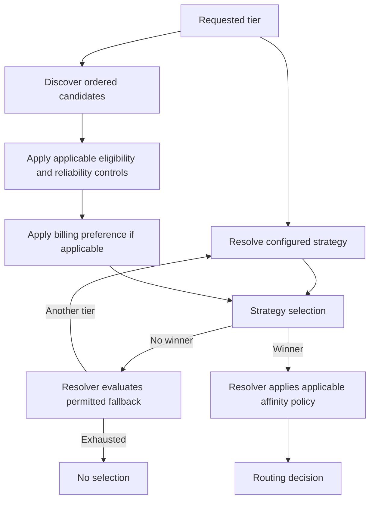

# Model-selection strategies

Bifrost uses a strategy to choose one model from an ordered candidate pool. This capability
implements the built-in strategies configured through `strategy` and `categoryStrategies`
in `bifrost.json`. It lets users prefer cost, context capacity, list order or random selection
without changing how Bifrost classifies a prompt or determines model eligibility.

A routing rule or classifier can identify a target tier, such as `quick` or `frontier`.
A strategy answers the next question: which candidate in the supplied pool should win?

## Example: choose a model within a tier

The following illustrative configuration assumes the named models exist in the registry.
The model identifiers and prices below are fictional.

```json
{
  "models": {
    "quick": ["example/a", "example/b", "example/c"],
    "frontier": ["example/a", "example/b", "example/c"]
  },
  "default": "quick",
  "strategy": "cheapest",
  "categoryStrategies": {
    "frontier": "largest_context"
  }
}
```

Suppose the resolver supplies these candidates in the listed order:

| Candidate | Input cost | Output cost | Context window |
| --- | ---: | ---: | ---: |
| `example/a` | 2 | 3 | 32000 |
| `example/b` | 1 | 5 | 64000 |
| `example/c` | 4 | 1.5 | 128000 |

Costs are illustrative prices per million tokens. For this pool, the default `cheapest`
strategy chooses A in the quick tier (combined cost 5). The frontier override chooses C
(context window 128000). The override changes selection policy, not membership.

| Strategy | Result for this pool |
| --- | --- |
| `first`, `fastest` | A (first in supplied order) |
| `cheapest` | A (lowest combined cost) |
| `cheapest_input` | B (lowest input cost) |
| `cheapest_output` | C (lowest output cost) |
| `largest_context` | C (largest context window) |
| `best_value` | C (lowest combined cost divided by context window) |
| `random` | A, B or C, depending on the draw |

These are selection results for the assumed pool, not guaranteed final routes or actual
provider prices. The engine does not measure latency for `fastest`, estimate the prompt's
actual token bill for `cheapest`, or measure model quality for `best_value`.

## Where strategies participate in routing

[`routing.ts`](../../routing.ts) owns strategy configuration precedence:
the target tier's `categoryStrategies` entry, then the top-level `strategy`, then
`first` if neither is supplied. Configuration loading and merging remain outside this module.



This diagram summarizes configured-tier routing; direct model references and simpler
resolver paths need not traverse every stage. The resolver supplies the ordered selection
pool and consumes the strategy result. Affinity retention can change the selected model
only under its own policy and within the applicable selection pool. Dispatch and live
revalidation remain with the host. The [resolve-only SDK](../../docs/router-api.md) uses the
shared routing resolver and returns advisory decisions, not authorization to dispatch.

## Ownership

This capability owns:

- the closed set of built-in strategy names and their single canonical order (`ALL_STRATEGIES`)
- the cost and context metrics (`modelCost`, `modelInputCost`, `modelOutputCost`,
  `modelContextSize`)
- the pick from an ordered candidate pool (`selectModel`)

Candidate discovery, classification, tiers, provider eligibility, sign-in, reserves,
billing preference, reliability and circuits, affinity, fallback and dispatch stay with
their existing owners.

## Inputs and outputs

`selectModel(candidates, strategy, random)` is synchronous and does not mutate its inputs:

- `candidates` is an ordered pool supplied by the caller. Selection never sorts or
  allocates replacement candidates.
- Each candidate exposes `cost.input`, `cost.output` and `contextWindow`; host objects
  may carry more fields, and generic inference preserves their type and identity.
- `strategy` is one of the eight names in `ALL_STRATEGIES`.
- `random` is an injectable draw, called once only for the random strategy with multiple
  candidates. The default is `Math.random`.

A returned candidate is the original member of the supplied pool. Empty input yields
`undefined`. A single candidate is returned without scoring or drawing. A nonempty
multi-candidate metric pool can also yield `undefined` when no comparable minimum exists.

## Behavior

| Strategy | Chooses |
| --- | --- |
| `first`, `fastest` | first candidate in list order |
| `cheapest` | lowest `input + output` cost (excludes cache costs) |
| `cheapest_input` | lowest input cost |
| `cheapest_output` | lowest output cost |
| `largest_context` | largest context window |
| `best_value` | lowest combined cost divided by context window |
| `random` | index `floor(draw * length)` |

Ties keep the earliest candidate. An unknown strategy name keeps the legacy first-candidate
fallback; callers validate names elsewhere. For multi-candidate random selection, a draw
outside the half-open interval from 0 (inclusive) to 1 (exclusive), including `NaN`,
selects the last candidate.

### Numeric edge behavior

The metric scan starts at positive infinity and replaces the winner only when the score
is strictly lower. For `largest_context` the score is the negative context window;
for `best_value` it is the combined cost divided by the context window.

- The lowest comparable score wins; equal scores keep the earliest candidate.
- `NaN` and positive infinity never win; negative infinity wins over finite scores.
- If every score is `NaN` or positive infinity, the result is `undefined`.
- Even finite inputs can produce non-finite scores, for example through cost addition
  overflow or division by zero.
- Missing `cost` throws when a multi-candidate cost-based strategy accesses it. The
  singleton path does not access metrics.

These are preserved behaviors, not permission to supply invalid model metadata or a
new validation policy.

## Design rationale and trade-offs

The strategies share a small structural candidate contract and a closed set of names.
A switch selects the relevant operation; metric-based strategies use a one-pass minimum
scan. This makes ordering and edge behavior explicit without requiring a class hierarchy,
strategy registry or dependency injection framework.

| Approach | Assessment |
| --- | --- |
| Sort the full pool | Unnecessary when only one winner is needed; requires sorting work and either mutates the pool or copies it. |
| One-pass scan (current) | Linear time and constant auxiliary space for metric selection; preserves list order, candidate identity and stable ties. |
| Direct indexing | Constant time for first, fastest and random; no metric scan required. |
| Extensible strategy registry | Could support dynamically registered policies, but adds lifecycle and compatibility concerns without an existing requirement. |

The cost and context strategies use simple metadata proxies. They do not account for
actual token usage, quality or observed latency. More sophisticated ranking would need
a separate behavior contract and evidence, not just a replacement implementation.

## Dependencies and effects

No runtime imports, I/O, host runtime, network, filesystem, clock, dispatch, credentials
or persisted state. Random selection uses the supplied callback or the default random
source; the module itself owns no random state.

## Compatibility

The strategy type and metric/selection functions remain available through the existing
`routing.ts` compatibility boundary, which preserves its published host-model signatures.
`config.ts` re-exports `ALL_STRATEGIES`. Configuration names and defaults are unchanged.

## Verification

```
node --test --experimental-strip-types modules/strategies/tests/selection.test.ts
node --test --experimental-strip-types modules/strategies/tests/selection-properties.test.ts
```

The full and quick tiers discover both files through the module test globs.
Mutation enrollment is declared in [`mutation.json`](mutation.json): the
capability owns the measured facts for `selection.ts`, while shared Stryker
policy stays in `mutation/config.mjs`. The module tests bind directly because
they import this capability. See
[`docs/mutation-testing.md`](../../docs/mutation-testing.md#capability-owned-enrollment).

## Extending or replacing

Add a strategy by updating the canonical list in [`selection.ts`](selection.ts), from which
the union is derived, implementing its behavior, and updating the schema enums and drift
guard in one change. Preserve the documented selection semantics, including ordering,
identity, tie-breaking and edge cases. Do not move eligibility, fallback or dispatch
authority into this capability. See [AGENTS.md](AGENTS.md).
